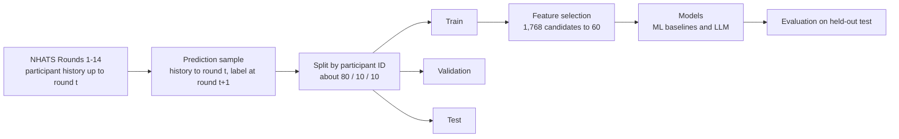

# Using Large Language Models to Improve ADRD Screening and Diagnosis in Rural U.S. Populations

**APHA 2026 poster · electronic version**

Peiqi Guo, MISM, MEM1, Runzhou Liu, MS2, Shengteng Yang, MS1, Mengyao Hu, PhD1, Aanand Naik, MD1, Hongru Du, PhD2 and Kaiming Bi, PhD2

1 The University of Texas Health Science Center at Houston, Houston, TX  
2 University of Virginia, Charlottesville, VA

## Contact

Peiqi Guo: peiqi.guo@uth.tmc.edu

## Contents

1. [Objective and background](#1-objective-and-background)
2. [Methods](#2-methods)
3. [Results](#3-results)
4. [Conclusion](#4-conclusion)
5. [Scope and limitations](#5-scope-and-limitations)
- [Appendix A: the 60 selected variables](#appendix-a-the-60-selected-variables)
- [Appendix B: glossary](#appendix-b-glossary)
- [References](#references) · [How to cite](#how-to-cite-this-poster) · [Contact](#contact)

## Glance of Summary
> **In one paragraph.** We asked whether a large language model (LLM) can predict a person's dementia status at their *next* annual interview from their earlier NHATS survey records. We first narrowed about 2,000 NHATS variables to a panel of 60 using mutual information, then fine-tuned an 8-billion-parameter LLM (Qwen3-VL-8B, text only) on text versions of those 60 variables. On a held-out test set that mirrors the real mix of dementia classes, the fine-tuned LLM reached a balanced accuracy of **0.762**, compared with **0.676** for the "no change" baseline and **0.583** for the same LLM without fine-tuning. It identified **73%** of participants whose dementia class worsened by the next round. Results are from a national NHATS sample; see [Scope and limitations](#5-scope-and-limitations).

## Key numbers

| | Value |
|---|---|
| NHATS data | Rounds 1–14 (2011–2024); 79,232 participant-round observations from 17,301 Medicare beneficiaries aged 65+ |
| Candidate variables ranked | 1,768 (475 significant at FDR q ≤ 0.05) |
| Selected panel | Top 60 variables, 8 domains |
| Strongest single variable | Delayed word recall: explains 9.7% of outcome uncertainty (NMI) |
| Test set | 1,000 held-out person-rounds at the natural class mix; 110 true progressions |
| Balanced accuracy: persistence / LLM zero-shot / LLM fine-tuned (250 labels) / LLM fine-tuned (8,000 labels) | 0.676 / 0.583 / 0.734 / **0.762** |
| Possible-dementia recall: persistence vs fine-tuned LLM (8,000 labels) | 0.28 vs **0.69** |
| Participants whose class worsened that were flagged by the fine-tuned LLM (8,000 labels) | **73%** (precision 0.30) |

---

## 1. Objective and background

**Background.** Alzheimer's disease and related dementias (ADRD) represent a growing public health crisis in the United States, with pronounced impacts in rural communities due to limited healthcare infrastructure and persistent health disparities. The need to strengthen ADRD surveillance, early detection, and care coordination in rural populations is paramount for improving individual health outcomes and informing targeted public health strategies.

**Objective.** Evaluate whether a large language model (LLM)-based approach can bolster Alzheimer's disease and related dementias (ADRD) risk prediction, enable earlier detection, and improve screening equity among rural U.S. residents.

---

## 2. Methods

### 2.1 Data

National Health and Aging Trends Study (NHATS), Rounds 1–14 (2011–2024): 79,232 participant-round observations from 17,301 Medicare beneficiaries aged 65+. The outcome is the NHATS dementia classification (no, possible, probable dementia).

<b>More detail: the outcome and the prediction samples</b>

**NHATS dementia classification** (Kasper et al., 2013). A participant is classed as:

| Class | Rule |
|---|---|
| Probable dementia | A reported doctor's diagnosis of dementia or Alzheimer's disease; or a proxy AD8 score of 2 or higher; or a score at least 1.5 standard deviations below the mean in two or more of three cognitive domains |
| Possible dementia | Impairment in exactly one of the three domains |
| No dementia | None of the above |

The three domains are memory (immediate and delayed recall of a 10-word list), orientation (the date, and naming the President and Vice President) and executive function (clock drawing).

**Prediction samples used for the LLM.** Each sample is one participant at one interview round *t*, with the label taken from round *t*+1. Building these pairs from the NHATS file gave 58,304 samples from 13,709 participants. Transitions to a *better* class (probable to possible, probable to no dementia, possible to no dementia; 3,482 pairs) were excluded, so every sample either stays in its class or worsens.

### 2.2 Study design

Using only information available through round *t*, predict dementia class at round *t*+1, mimicking prospective screening. Participants were assigned to training, validation, and test sets (≈80/10/10) by participant ID, so no individual appears in more than one set. Reverse transitions (probable to no dementia) were excluded.

<b>More detail: sample sizes and splits</b>

| Item | Value |
|---|---|
| Prediction samples (LLM dataset) | 58,304 |
| Participants represented | 13,709 |
| Training split | 46,753 samples |
| Validation split | 5,879 samples |
| Test split | 5,672 samples |
| Excluded transitions to a better class | 3,482 pairs (probable to possible 451; probable to no dementia 352; possible to no dementia 2,679) |
| Test sets used for the figures | Two 1,000-sample draws from the test split: one at the natural class mix (15% probable, 10% possible, 75% no dementia; 110 true progressions) and one class-balanced (1:1:1; 309 true progressions) |

A *progression* is a case whose class at *t*+1 is worse than at *t*: no dementia to possible, no dementia to probable, or possible to probable.

### 2.3 Feature selection

We ranked 1,768 candidate NHATS variables by chance-corrected normalized mutual information (NMI) with next-round change in dementia class. 475 were significant (FDR q ≤ 0.05); the top 60 (elbow of the ranked curve) formed a shared low-cost input panel spanning 8 domains.

<b>More detail: what mutual information measures</b>

**Mutual information (MI)** is the average amount by which knowing one variable reduces uncertainty about the outcome (Shannon, 1948; Cover & Thomas, 2006). Uncertainty is measured by entropy, H(Y), and

> MI(X; Y) = H(Y) − H(Y | X)

**Normalized MI (NMI)** divides MI by H(Y), so it reads as the share of outcome uncertainty a variable explains.

*Worked example.* Take 100 people, 20 of whom progress, so H(Y) = 0.500 nats. Half have low delayed recall (16 of 50 progress, risk 32%) and half have high recall (4 of 50 progress, risk 8%). Knowing recall lowers the average remaining uncertainty to 0.453 nats. MI is 0.048 nats, which is 9.5% of H(Y). In the real data, delayed word recall explains 9.7%.

<b>More detail: the selection pipeline</b>

| Step | Variables | What was done |
|---|---:|---|
| Analysis file | 2,005 columns | One row per pair of consecutive interviews for the same person; 52,939 pairs, each with a clock drawing in both rounds |
| Candidates | 1,768 | Removed identifiers, round numbers, current and next-round dementia class, transition codes and survey weights |
| Scored | 540 | Kept variables with at most 50% missing values, at least 500 complete rows, and more than one value; negative NHATS codes (inapplicable, refused, don't know, missing, not collected) treated as missing, no imputation |
| Above chance | 475 | Permutation test with false discovery rate q ≤ 0.05 (Benjamini & Hochberg, 1995) |
| Selected | 60 | Top 60 by NMI, at the elbow of the ranked curve (Satopää et al., 2011) |

- **Outcome used for ranking:** change in dementia class from *t* to *t*+1 in seven categories (no change 47,971; no dementia to possible 3,008; no dementia to probable 951; possible to probable 830; three small groups whose next-round class was coded −1, 179 pairs). H(Y) = 0.412 nats.
- **Scoring:** one estimator for all variables, MI from a contingency table (scikit-learn; Pedregosa et al., 2011). Variables with more than 10 distinct values were first cut into 10 equal-frequency groups.
- **Chance correction:** the outcome was shuffled five times per variable and the average chance-level MI subtracted (Paninski, 2003, discusses the upward bias of MI estimates). The result divided by H(Y) is the NMI.
- **Other cut-offs considered:** 40 variables with NMI of at least 2%; 161 variables to reach 80% of the cumulative NMI.

### 2.4 Models

**Machine-learning baselines:** LASSO, random forest, XGBoost, focal-loss CNN (current round only) and a Transformer (full history). **LLM:** Qwen3-VL-8B (text only), zero-shot and LoRA fine-tuned, reading each participant's chronological history as a standardized text prompt with a structured JSON output. Evaluation metrics including macro F1, balanced accuracy, AUC-ROC, accuracy.

<b>More detail: how the LLM was set up and trained</b>

| Item | Setting |
|---|---|
| Model | Qwen3-VL-8B, language model only (no images) (Bai et al., 2025) |
| Input | The 60 variables for every round from 1 to *t*, rendered as a short text paragraph per round in a fixed format. Items skipped by design appear as "n/a"; items not asked in a round appear as "not collected this round". A history averages about 3,600 tokens (about 9,200 for 13 rounds). |
| Zero-shot | The same model with the same prompt and no fine-tuning |
| Fine-tuning | LoRA (Hu et al., 2022), rank 16, which trains about 0.5% of the model's weights |
| Training data | Nested random draws of 250, 500, 1,000, 2,000, 4,000 and 8,000 examples from the 46,753-example training split, class-balanced 1:1:1. Each smaller set is contained in the next larger one. |
| Epochs | The epoch with the lowest validation loss was kept (epoch budgets of 12, 10, 8, 6 and 5 for 250 to 4,000 examples; 3 for 8,000) |
| Prediction | The model's probabilities over the three class labels (1 = probable, 2 = possible, 3 = no dementia) are compared, and predictions better than the participant's current class are not allowed, because such transitions were excluded from the data. |
| Seeds | One training run per point |
| Run-to-run noise | About ±0.012 in balanced accuracy for one setting rerun on different hardware |

### 2.5 Evaluation measures

| Measure | Meaning |
|---|---|
| Balanced accuracy | The average of the recall for the three classes (probable, possible, no dementia). Chance level for predicting everyone as "no dementia" is 0.333. |
| Persistence baseline | Predict that next round's class equals the current class. About nine in ten people do not change class, so this baseline is strong, but it can never detect worsening. |
| Possible-dementia recall | Of the participants who are in the possible-dementia class at the next round, the share predicted as possible dementia |
| Progression caught (recall) | Of the participants whose class worsens at the next round, the share the model flagged (any prediction worse than the current class) |
| Precision (prec.) | Of all participants flagged as worsening, the share who did worsen |
| Macro F1, accuracy, AUC-ROC | Standard classification measures listed in the poster's Methods |

---

## 3. Results

### 3.1 A compact panel

60 of ~2,000 NHATS variables carried most of the predictive information. Delayed word recall ranked first (9.7% of outcome uncertainty explained), followed by immediate recall (8.2%), clock drawing (4.6%) and SPPB physical performance (4.4%).

*Figure 1.* (a) NMI of the 60 selected variables, by rank. (b) Variables per domain.

<b>Data behind Figure 1</b>

**Top 10 variables**

| Rank | Variable | What it records | NMI (%) |
|---:|---|---|---:|
| 1 | `cgdwrddlyrc` | Delayed word recall (words recalled out of 10) | 9.7 |
| 2 | `cgdwrdimmrc` | Immediate word recall (words recalled out of 10) | 8.2 |
| 3 | `cgdclkdraw` | Clock drawing score | 4.6 |
| 4 | `dnhatssppb` | Short Physical Performance Battery total, NHATS scoring | 4.4 |
| 5 | `dorigsppb` | Short Physical Performance Battery total, original scoring | 4.3 |
| 6 | `dorigwksc` | Walking-speed component score, original scoring | 4.2 |
| 7 | `cgvpname1` | Named the Vice President's last name correctly | 4.2 |
| 8 | `cgvpname2` | Vice President's last name incorrect or not known | 4.2 |
| 9 | `dnhatswksc` | Walking-speed component score, NHATS scoring | 4.1 |
| 10 | `wawlkc2secs` | Seconds to complete the walking course, trial 2 | 4.0 |

**Variables per domain**

| Domain | Variables | Best rank |
|---|---:|---:|
| A. Cognitive tests (NHATS dementia classification) | 15 | 1 |
| B. Self-rated memory and interviewer-rated comprehension | 2 | 57 |
| C. Measured physical performance | 16 | 4 |
| D. Self-reported physical capacity and mobility aids | 7 | 41 |
| E. Everyday activities (IADLs) and managing health | 10 | 35 |
| F. Driving and transportation | 5 | 14 |
| G. Technology use | 3 | 16 |
| H. Age and survey timing | 2 | 17 |
| **Total** | **60** | |

**Cumulative NMI.** Ranks 1–40 sum to 40% and ranks 1–60 to 50% of the NMI summed over all scored variables; 161 variables are needed to reach 80%. NMI values are not additive across overlapping variables, so these percentages describe the ranking rather than the share of total predictive information. The full list of 60 variables is in [Appendix A](#appendix-a-the-60-selected-variables).

### 3.2 The fine-tuned LLM compared with machine learning and simple baselines

On 1,000 held-out person-rounds at the natural class mix, the fine-tuned LLM reached a balanced accuracy of 0.762, above a longitudinal Transformer (0.704) and XGBoost (0.512) trained on all 46,753 training examples and evaluated on the full test split. The LLM and the Transformer both beat the persistence baseline of carrying the current class forward (0.676); XGBoost did not. Without fine-tuning, the same LLM reached 0.583.

*Figure 2.* Predicting next-round dementia class: overall discrimination. Test set: 1,000 held-out NHATS person-rounds at the natural class mix (75% no / 10% possible / 15% probable dementia; 110 true progressions). LLM = Qwen3-VL-8B (text only), 60 MI-selected variables, LoRA fine-tuned on class-balanced (1:1:1) examples. † ML values are from the full test split (same population and class mix, not the same 1,000 samples).

<b>Data behind Figure 2</b>

| Model | Balanced accuracy |
|---|---:|
| Always "no dementia" | 0.333 |
| Persistence (repeat current class) | 0.676 |
| XGBoost, 46,753 labels † | 0.512 |
| Transformer, full history, 46,753 labels † | 0.704 |
| LLM zero-shot (no training) | 0.583 |
| LLM fine-tuned, 250 labels | 0.734 |
| LLM fine-tuned, 8,000 labels | **0.762** |

† See the footnote to Figure 2 above.

### 3.3 Earlier detection

The fine-tuned LLM identified 69% of possible-dementia cases, vs. 28% for persistence, and flagged 73% of participants whose dementia class worsened by the next round. Persistence cannot detect change by design. About three in ten flags were a true progression (precision 0.30), suitable for a first-stage screen that triggers follow-up assessment.

*Figure 3.* Predicting next-round dementia class: early-stage detection. Test set as in Figure 2. prec. = share of flagged progressions that were real. Persistence cannot flag progression by design.

<b>Data behind Figure 3</b>

| Model | Possible-dementia recall | Progression caught (recall) | Precision of progression flags |
|---|---:|---:|---:|
| Persistence | 0.28 | 0.00 | n/a (no flags) |
| LLM zero-shot | 0.12 | 0.60 | 0.22 |
| LLM fine-tuned, 250 labels | 0.52 | 0.64 | 0.32 |
| LLM fine-tuned, 8,000 labels | **0.69** | **0.73** | 0.30 |

With 110 true progressions among 1,000 test person-rounds, a progression rate of 11%, a precision of 0.30 is about 2.7 times the rate expected from flagging at random.

### 3.4 How much labeled data is needed

*Figure 4.* LLM performance vs. amount of labeled training data. Qwen3-VL-8B (text only) + LoRA on 1:1:1 balanced nested training draws; best epoch by validation loss; one seed per point (noise floor ≈ ±0.012). 250 labels reach 96% of the 8,000-label score (0.734 vs 0.762).

<b>Data behind Figure 4 (balanced accuracy)</b>

| Labeled training examples | Natural class-mix test (n = 1,000) | Balanced test (n = 1,000) |
|---:|---:|---:|
| 0 (zero-shot) | 0.583 | 0.569 |
| 250 | 0.734 | 0.717 |
| 500 | 0.739 | 0.720 |
| 1,000 | 0.746 | 0.723 |
| 2,000 | 0.774 | 0.763 |
| 4,000 | 0.774 | 0.751 |
| 8,000 | 0.762 | 0.752 |
| *Persistence, natural test* | *0.676* | |
| *Transformer reference line (natural test)* | *0.704* | |

Differences smaller than about 0.02 between neighbouring points are within run-to-run noise (one training run per point). The curve rises steeply up to 250 labels and is roughly flat from 2,000 labels upward.

---

## 4. Conclusion

An LLM-driven framework offers a scalable, cost-effective strategy for ADRD screening in rural populations, potentially deployable via smartphones or telehealth platforms. By supporting earlier intervention and more equitable resource distribution, this approach can help mitigate disparities in underserved areas.

---

## 5. Scope and limitations

These points help readers interpret the results above.

- **Population.** The data are a national sample of Medicare beneficiaries aged 65 and older (NHATS). The analyses on this poster do not stratify by rural or urban residence, and no result is specific to rural participants. The rural framing of the objective and conclusion describes motivation and intended use, not a tested finding.
- **Outcome.** The outcome is the NHATS dementia classification, a rule-based research classification, not a clinical diagnosis.
- **Input variables overlap the outcome definition.** Several of the 60 variables (word recall, naming the President and Vice President, clock drawing) are the tests NHATS uses to assign the dementia class. They are measured at round *t* while the outcome is at round *t*+1, but part of the panel's predictive value reflects the outcome's own definition.
- **Overlapping variables.** Some selected variables are derived from others (for example the SPPB total and its component scores, or the recall total and individual recalled words), and some are two scorings of the same test. Removing such overlaps and repeating the selection is planned.
- **Number of variables.** The size of the panel (60) was set at the elbow of the ranked NMI curve. A sensitivity analysis of how results change with the number of variables is planned.
- **Single runs and small test sets.** Each LLM setting was trained once. The natural-mix test set has 1,000 person-rounds with 110 true progressions, so estimates are imprecise, and differences below about 0.02 in balanced accuracy should not be interpreted.
- **Training mix versus test mix.** The LLM was fine-tuned on class-balanced data and evaluated on a test set with the natural class mix. This raises recall for possible dementia and for progression, and lowers precision: about three in ten flags were true progressions.
- **The prediction rule uses the current class.** Predictions of a better class than the participant's current class are not allowed, so the rule draws on the current class (as does the persistence baseline), even though the class is not part of the text the model reads.
- **Machine-learning comparison.** The machine-learning values are not scored on the same 1,000 test person-rounds as the LLM (see the footnote to Figure 2). A comparison of all models on identical samples and identical inputs is planned.
- **Not yet evaluated.** Performance by subgroup (including rural-urban residence, race and ethnicity, and education), external validation, and calibration.

---

## Appendix A: the 60 selected variables

NMI (%) is the share of outcome uncertainty each variable explains, ranked within all 540 scored variables. Variable names are NHATS variable names.

<b>Show all 60 variables, grouped by domain</b>

#### A. Cognitive tests (NHATS dementia classification) (15 variables)

| Rank | Variable | What it records | Response | NMI (%) |
|---:|---|---|---|---:|
| 1 | `cgdwrddlyrc` | Memory: Delayed word recall: number of the 10 list words recalled after a delay filled with other questions | 0–10 words | 9.7 |
| 2 | `cgdwrdimmrc` | Memory: Immediate word recall: number of the 10 list words recalled right after hearing them | 0–10 words | 8.2 |
| 3 | `cgdclkdraw` | Executive function: Clock drawing score (draw a clock showing 10 past 11) | 0 not recognizable … 5 accurate | 4.6 |
| 7 | `cgvpname1` | Orientation: Named the Vice President's last name correctly | Selected / not selected | 4.2 |
| 8 | `cgvpname2` | Orientation: Vice President's last name incorrect or not known | Selected / not selected | 4.2 |
| 12 | `cgvpname3` | Orientation: Named the Vice President's first name correctly | Selected / not selected | 3.7 |
| 13 | `cgvpname4` | Orientation: Vice President's first name incorrect or not known | Selected / not selected | 3.7 |
| 15 | `cgwrdsdcal1` | Memory: Delayed recall, first stored response slot: which list word was recorded first | Word position 1–10 on the assigned list | 3.4 |
| 19 | `cgpresidna4` | Orientation: President's first name incorrect or not known | Selected / not selected | 3.1 |
| 20 | `cgpresidna3` | Orientation: Named the President's first name correctly | Selected / not selected | 3.1 |
| 24 | `cgdwrd1dly` | Memory: Delayed recall of word 1 on the assigned list | Recalled / not recalled | 2.8 |
| 27 | `cgdwrd2dly` | Memory: Delayed recall of word 2 | Recalled / not recalled | 2.6 |
| 46 | `cgdwrd4dly` | Memory: Delayed recall of word 4 | Recalled / not recalled | 1.9 |
| 51 | `cgdwrd7dly` | Memory: Delayed recall of word 7 | Recalled / not recalled | 1.8 |
| 60 | `cgdwrd3dly` | Memory: Delayed recall of word 3 | Recalled / not recalled | 1.5 |

#### B. Self-rated memory and interviewer-rated comprehension (2 variables)

| Rank | Variable | What it records | Response | NMI (%) |
|---:|---|---|---|---:|
| 57 | `irundrstand` | Interviewer's rating of how well the respondent understood the questions | Good, fair, poor | 1.7 |
| 58 | `cgratememry` | Self-rated memory | Excellent, very good, good, fair, poor | 1.6 |

#### C. Measured physical performance (16 variables)

| Rank | Variable | What it records | Response | NMI (%) |
|---:|---|---|---|---:|
| 4 | `dnhatssppb` | SPPB summary: Short Physical Performance Battery total, NHATS scoring | 0–12 (higher = better) | 4.4 |
| 5 | `dorigsppb` | SPPB summary: Short Physical Performance Battery total, original scoring (Guralnik et al., 1994) | 0–12 (higher = better) | 4.3 |
| 6 | `dorigwksc` | Gait: Walking-speed component score, original scoring | 0–4 | 4.2 |
| 9 | `dnhatswksc` | Gait: Walking-speed component score, NHATS scoring | 0–4 | 4.1 |
| 10 | `wawlkc2secs` | Gait: Seconds to complete the walking course, trial 2 | Seconds | 4.0 |
| 11 | `wawlkc1secs` | Gait: Seconds to complete the 3-metre walking course, trial 1 | Seconds | 4.0 |
| 21 | `dnhatsbasc` | Balance: Balance component score, NHATS scoring | 0–4 | 3.1 |
| 23 | `pkpkarfl1rd` | Peak expiratory flow: Peak expiratory flow, trial 1 | L/min | 2.9 |
| 26 | `dorigbasc` | Balance: Balance component score, original scoring | 0–4 | 2.6 |
| 28 | `pkpkarfl2rd` | Peak expiratory flow: Peak expiratory flow, trial 2 | L/min | 2.5 |
| 29 | `dnhatspkav` | Peak expiratory flow: Average of the valid peak-flow readings | L/min | 2.5 |
| 30 | `dorigchsc` | Chair stands: Repeated chair-stand component score, original scoring | 0–4 | 2.4 |
| 31 | `dnhatschsc` | Chair stands: Repeated chair-stand component score, NHATS scoring | 0–4 | 2.4 |
| 33 | `dnhatspkb` | Peak expiratory flow: Best valid peak-flow reading | L/min | 2.3 |
| 34 | `badblopadm` | Balance: Whether the one-leg (eyes open) stand was administered, and if not, why | Administration status | 2.2 |
| 55 | `badblftadm` | Balance: Whether the full-tandem stand was administered, and if not, why | Administration status | 1.7 |

#### D. Self-reported physical capacity and mobility aids (7 variables)

| Rank | Variable | What it records | Response | NMI (%) |
|---:|---|---|---|---:|
| 41 | `dmdmodevgr` | Number of months mobility devices were used since the last interview (grouped) | Duration categories | 2.0 |
| 44 | `pccar20pnds` | Able to carry 20 pounds by self in the last month | Yes / no | 1.9 |
| 49 | `pcup20stair` | Able to walk up 20 stairs by self in the last month | Yes / no | 1.8 |
| 50 | `modoutdevi` | Used a mobility device when going outside in the last month | Yes / no | 1.8 |
| 52 | `mdcanewlker` | Used a cane, walker, wheelchair or scooter in the last month | Yes / no | 1.8 |
| 53 | `modinsddevi` | Used a mobility device to get around inside the home in the last month | Yes / no | 1.8 |
| 54 | `pcwalk6blks` | Able to walk 6 blocks (about half a mile) by self, without a cane or walker, in the last month | Yes / no | 1.7 |

#### E. Everyday activities (IADLs) and managing health (10 variables)

| Rank | Variable | What it records | Response | NMI (%) |
|---:|---|---|---|---:|
| 35 | `hadmealreas` | Meals: If others helped with or made hot meals: why | Health or functioning, other reason, both | 2.1 |
| 36 | `mcmedstrk` | Medications: How keeping track of prescribed medicines (right amount, right time) was done in the last month | By self, with someone, someone else did it, varied, not done | 2.1 |
| 37 | `hadshopreas` | Shopping: If others helped with or did the shopping: why | Health or functioning, other reason, both | 2.1 |
| 39 | `hadshopsfdf` | Shopping: Summary of doing one's own shopping and the difficulty involved | Ordinal: by self without difficulty → not done by self | 2.0 |
| 42 | `mcansitindr` | Medical visits: In the last year, someone sat in with the participant during visits with their regular doctor | Yes / no | 1.9 |
| 43 | `hadbanksfdf` | Finances: Summary of handling bills and banking oneself and the difficulty involved | Ordinal: by self without difficulty → not done by self | 1.9 |
| 45 | `mcdmedssfdf` | Medications: Summary of managing one's own medications and the difficulty involved | Ordinal: by self without difficulty → not done by self | 1.9 |
| 47 | `hashop` | Shopping: How shopping got done in the last month | By self, with someone, someone else did it, varied, not done | 1.9 |
| 48 | `ewpycredbal` | Finances: How the participant (and spouse or partner) usually pay credit-card balances | Pay off, pay minimum, pay more than minimum, no credit cards | 1.8 |
| 59 | `mchowpkupm1` | Medications: Picked up own prescriptions from a local store or pharmacy in the last month | Selected / not selected | 1.6 |

#### F. Driving and transportation (5 variables)

| Rank | Variable | What it records | Response | NMI (%) |
|---:|---|---|---|---:|
| 14 | `mchwgtregd1` | Drove self to regular doctor visits | Selected / not selected | 3.4 |
| 25 | `dtdriveyr` | Drove at all since the last interview (asked of participants who ever drove) | Yes / no, no longer drives | 2.7 |
| 32 | `mchwgtregd2` | Got a ride to the doctor from family, friends or a paid helper | Selected / not selected | 2.3 |
| 38 | `hahowgtstr1` | Drove self to the store for groceries or personal items in the last year | Selected / not selected | 2.0 |
| 56 | `dtoftedrive` | How often drives | Every day … never | 1.7 |

#### G. Technology use (3 variables)

| Rank | Variable | What it records | Response | NMI (%) |
|---:|---|---|---|---:|
| 16 | `teonline` | Went online for any other reason in the last month (besides email or texting) | Yes / no | 3.3 |
| 18 | `teemailtext` | Sent email or text messages in the last month | Yes / no | 3.2 |
| 40 | `tecomputer` | Has a working desktop or laptop computer at home | Yes, no, yes but does not know how to use it | 2.0 |

#### H. Age and survey timing (2 variables)

| Rank | Variable | What it records | Response | NMI (%) |
|---:|---|---|---|---:|
| 17 | `d2intvrage` | Age group at interview | 65–69, 70–74, 75–79, 80–84, 85–89, 90+ | 3.2 |
| 22 | `abdateyear` | Year the interviewer recorded on the Activities Booklet cover | Year | 3.0 |

## Appendix B: glossary

| Term | Meaning |
|---|---|
| ADRD | Alzheimer's disease and related dementias |
| NHATS | National Health and Aging Trends Study: a nationally representative panel of U.S. Medicare beneficiaries aged 65 and older, interviewed in person every year since 2011 (Freedman & Kasper, 2019) |
| Person-round | One participant at one interview round |
| Progression | A worsening of dementia class between consecutive rounds |
| LLM | Large language model |
| Zero-shot | Using a model with no training on the task |
| LoRA | Low-rank adaptation: fine-tuning a small number of added weights while the rest of the model stays fixed |
| Persistence baseline | Predicting that the next class equals the current class |
| Entropy, H(Y) | A measure of uncertainty about an outcome |
| Mutual information (MI) | The average reduction in uncertainty about the outcome after learning one variable |
| NMI | Normalized mutual information: MI divided by H(Y) |
| FDR | False discovery rate |
| Elbow | The point on the ranked NMI curve after which extra variables add little |
| SPPB | Short Physical Performance Battery: balance, walking speed and repeated chair stands |
| Balanced accuracy | The average recall across the three classes |

## References

Bai, S., Cai, Y., Chen, R., Chen, K., Chen, X., Cheng, Z., Deng, L., Ding, W., Gao, C., Ge, C., Ge, W., Guo, Z., Huang, Q., Huang, J., Huang, F., Hui, B., Jiang, S., Li, Z., Li, M., … Zhu, K. (2025). *Qwen3-VL technical report*. arXiv. https://doi.org/10.48550/arXiv.2511.21631

Benjamini, Y., & Hochberg, Y. (1995). Controlling the false discovery rate: A practical and powerful approach to multiple testing. *Journal of the Royal Statistical Society: Series B (Methodological), 57*(1), 289–300.

Cover, T. M., & Thomas, J. A. (2006). *Elements of information theory* (2nd ed.). Wiley.

Freedman, V. A., & Kasper, J. D. (2019). Cohort profile: The National Health and Aging Trends Study (NHATS). *International Journal of Epidemiology, 48*(4), 1044–1045g. https://doi.org/10.1093/ije/dyz109

Hu, E. J., Shen, Y., Wallis, P., Allen-Zhu, Z., Li, Y., Wang, S., Wang, L., & Chen, W. (2022). LoRA: Low-rank adaptation of large language models. *International Conference on Learning Representations*. https://openreview.net/forum?id=nZeVKeeFYf9

Kasper, J. D., Freedman, V. A., & Spillman, B. C. (2013). *Classification of persons by dementia status in the National Health and Aging Trends Study* (NHATS Technical Paper No. 5). Johns Hopkins University School of Public Health. www.NHATS.org

Paninski, L. (2003). Estimation of entropy and mutual information. *Neural Computation, 15*(6), 1191–1253. https://doi.org/10.1162/089976603321780272

Pedregosa, F., Varoquaux, G., Gramfort, A., Michel, V., Thirion, B., Grisel, O., Blondel, M., Prettenhofer, P., Weiss, R., Dubourg, V., Vanderplas, J., Passos, A., Cournapeau, D., Brucher, M., Perrot, M., & Duchesnay, É. (2011). Scikit-learn: Machine learning in Python. *Journal of Machine Learning Research, 12*, 2825–2830.

Satopää, V., Albrecht, J., Irwin, D., & Raghavan, B. (2011). Finding a "kneedle" in a haystack: Detecting knee points in system behavior. In *2011 31st International Conference on Distributed Computing Systems Workshops* (pp. 166–171). IEEE. https://doi.org/10.1109/ICDCSW.2011.20

Shannon, C. E. (1948). A mathematical theory of communication. *Bell System Technical Journal, 27*(3), 379–423.

## How to cite this poster

Guo, P., Liu, R., Yang, S., Hu, M., Naik, A., Du, H., & Bi, K. (2026). *Using large language models to improve ADRD screening and diagnosis in rural U.S. populations* [Poster presentation]. American Public Health Association (APHA) 2026 Annual Meeting.

## Data availability

NHATS data are available from the study at https://www.nhats.org.

